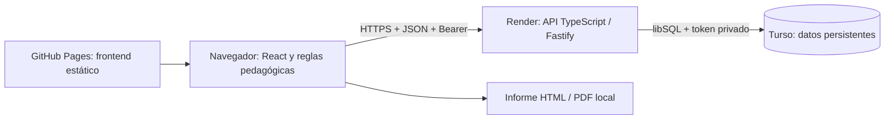

# Arquitectura final y límites de KoraMAP

Estado del prototipo al **5 de noviembre de 2026**. Este documento describe el código implementado; sustituye las propuestas iniciales de PWA offline y FastAPI. Contrato detallado: [backend/README.md](../backend/README.md). Datos y garantías: [datos-y-seguridad.md](datos-y-seguridad.md).

## Es una aplicación web online

**KoraMAP necesita conexión a Internet. No tiene modo offline.** La interfaz se sirve como web estática y consume una API externa que autentica, autoriza y guarda los datos en una base remota. Acceder con un QR, añadir un acceso directo o abrirla a pantalla completa no cambia ese requisito.

No se registran service workers de caché, no hay IndexedDB con expedientes ni cola persistente de cambios. `app/src/main.tsx` retira el antiguo service worker y su caché. Una pantalla ya cargada puede seguir mostrando información y ejecutando interacciones en memoria al perder la red, pero **no puede garantizar guardar el progreso, cargar alumnos, iniciar sesión ni desbloquear el modo profesional**. Un cambio sin confirmar se puede perder al cerrar o recargar.

La descarga de un informe es una excepción limitada: el archivo HTML ya exportado incluye los datos del informe y, si se pudieron cargar, el logo y el motor de PDF. Puede abrirse/imprimirse después de descargarlo. Ese archivo no permite jugar, consultar la cuenta ni sincronizar cambios sin conexión; no constituye modo offline de la aplicación.

## Componentes y despliegue

| Capa | Tecnologías | Responsabilidad |
|---|---|---|
| Frontend `app/` | React 19, TypeScript, Vite, Tailwind CSS | Login, alumnos, juegos, panel profesional, resumen familiar y cinco idiomas ES/EN/FR/AR/UK, incluido RTL. |
| Informes | Reglas en `aiPedagogy.ts`, plantillas HTML, html2pdf.js | Generar observaciones y recomendaciones orientativas en el navegador. No llama a Claude ni a otro modelo externo. |
| API `backend/` | TypeScript, Fastify, Zod, Node 22.12+ | Validar entradas, gestionar cuentas/sesiones, permisos, CRUD y escrituras versionadas. |
| BBDD | SQLite/libSQL mediante `@libsql/client` | Archivo local para desarrollo; libSQL remoto en Turso para la demo. Sin ORM. |
| Verificación | TypeScript, node:test, Playwright, GitHub Actions | Tipos, unitarios, build y recorridos de navegador con API/base en memoria; pruebas remotas solo opt-in. |

URLs de la demo: [frontend](https://floren87.github.io/hack4edu-2026/), API base `https://hack4edu-2026.onrender.com/api`, [healthcheck](https://hack4edu-2026.onrender.com/api/health). El navegador conecta directamente con `VITE_API_BASE_URL`; no necesita proxy de Netlify ni de Vite. Render permite el origen exacto `https://floren87.github.io`, sin la subcarpeta de Pages.

El frontend se publica al integrar en `main`. `develop` fue integrada y eliminada después del PR #36; esta entrega parte de `main` y vuelve por PR, con aprobación de Miguel. **Antes del próximo redeploy de Render, comprobar que su Branch sea `main`**, porque una configuración que conserve `develop` fallará al buscar esa rama. Este sprint no modifica el servicio ni las credenciales de Turso. Ver [despliegue y operación](equipo/despliegue-demo.md).

## Sesión y separación profesional/niño

1. El profesional registra un usuario inventado y contraseña. No se exige email ni identidad real.
2. La API verifica la contraseña con scrypt y devuelve un token opaco de ocho horas. El navegador conserva token/caducidad en `sessionStorage`, con clave por URL de API; envía `Authorization: Bearer` y omite cookies.
3. En modo profesional se muestran el usuario de cuenta, sus alumnos, sus resultados, revisión y exportaciones. Cada consulta se limita al propietario de los datos.
4. La API fija el modo niño y su alumno activo en la sesión. El niño solo ve juegos y el backend oculta notas profesionales y rechaza las operaciones profesionales.
5. Volver al Perfil Docente requiere comprobar la contraseña en la API. No basta con cambiar una variable en el navegador. Logout revoca el token.

Una pestaña independiente requiere login; una duplicada puede heredar el token y compartir modo/revocación. El token es accesible al JavaScript del origen: este mecanismo no elimina el riesgo de XSS.

## Modelo de datos y guardado

| Tabla | Datos principales |
|---|---|
| `accounts` | ID, usuario único, hash/sal de contraseña y fecha de creación. |
| `sessions` | SHA-256 del token, propietario, modo, alumno activo y caducidad. `csrf_token` queda vacío por compatibilidad con el esquema inicial. |
| `students` | ID, propietario, perfil/progreso/revisión en JSON, versión y fecha de actualización. |

El esquema se inicializa con `CREATE TABLE IF NOT EXISTS`; no se importa automáticamente la base local a Turso. El JSON permite conservar la estructura del prototipo sin añadir tablas por cada juego. No existe un servidor PostgreSQL/MySQL ni un historial versionado de evaluaciones.

El frontend agrupa cambios en memoria y serializa escrituras. Cada modificación utiliza la versión conocida del alumno; una versión obsoleta devuelve `409 VERSION_CONFLICT` y exige cargar el estado remoto. «Guardado» significa que la API confirmó la operación. Las nuevas partidas conservan las notas del docente y dejan pendiente una nueva validación. La revisión del profesional se guarda al pulsar su botón, no al editar el texto.

## Límites deliberados del prototipo

- Solo estado actual y última revisión, aunque se conserva un registro limitado de partidas para los informes. No hay snapshots históricos de evaluaciones.
- Sin recuperación de contraseñas, email, MFA, borrado de cuenta por autoservicio, panel compartido de centro ni verificación de que una cuenta pertenezca a un profesional real.
- Máximo 50 alumnos/cuenta, 500 registros de juego/alumno, 2000 caracteres de notas y 256 KiB por petición. Registro/login/desbloqueo: 60 intentos/minuto por IP/ruta; otros límites: ver API. Una wifi/NAT puede compartir cuota.
- No hay sincronización offline ni fusión de cambios entre dispositivos. Evitar partidas simultáneas sobre el mismo alumno y esperar confirmación antes de cerrar.
- El hosting gratuito puede suspenderse o alcanzar cuotas; no se ha medido aforo ni garantizado disponibilidad. Probar la red de la presentación y abrir el healthcheck con antelación.
- La voz depende del navegador y sus voces instaladas. El rango validado en la API es 7–14 años; el texto de interfaz indica «desde 7 años».
- Los resultados son reglas y métricas del juego, no puntuaciones psicométricas validadas. La API no certifica que un dispositivo envíe métricas verdaderas. El profesional interpreta y decide; el prototipo no diagnostica ni asigna curso/grupo automáticamente.

## Marca y mantenimiento

El logo aprobado por el equipo es `app/public/koramap-logo.jpeg`, copiado sin alterar sus bytes. `AppLogo` utiliza su miniatura PNG de 192 px; los iconos SVG/PNG, la página de privacidad y los informes usan la misma marca. `npm run brand:generate` genera los iconos conservando proporciones y sin recortar el original; requiere el navegador de Playwright (Edge en Windows o Chromium en Linux). Las pruebas comprueban la fuente aprobada, tamaños, carga de imágenes y exportación.

Las mejoras pendientes de producción —operación, conservación, responsables y uso con menores reales— se detallan en [datos y seguridad](datos-y-seguridad.md). El backend y el frontend se mantienen desacoplados: cambiar de hosting requiere revisar la URL pública y los orígenes permitidos, no rediseñar los juegos.
